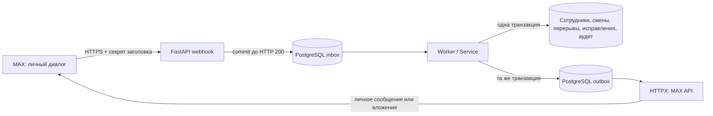

# Архитектура и эксплуатация

## Поток события



`app/events.py` проверяет форму поддерживаемых событий и извлекает стабильный `user_id`. `app/web.py` проверяет секрет до разбора тела. Групповые сообщения и callback без исходного личного сообщения игнорируются. `bot_started` по официальной схеме относится к личному диалогу.

`app/service.py` не обращается к сети и не зависит от SDK MAX. Он получает нормализованный запрос, проверяет роль/статус и формирует задания для доставки. `app/timecalc.py` содержит чистые функции времени и CSV. `app/max_api.py` — единственное место с HTTP-контрактами MAX.

Входящая очередь записывается под отдельной транзакционной advisory-блокировкой для согласования порядка commit и ID. Обработка выполняется под общей бизнес-блокировкой в порядке inbox ID. Входящий webhook не ждет бизнес-операций или MAX API. Завершение обработки события, учет и очередь исходящих ответов фиксируются одним commit. Успешно обработанное тело события очищается, ключ дедупликации сохраняется.

Модификации сотрудники/смены/исправления идут под одной блокировкой. Это ограничивает пропускную способность, но упрощает гарантии корректности, включая проверки пересечений при одобрении исправления. SQL-индексы дополнительно запрещают несколько открытых смен и активных перерывов. Для роста нагрузки можно заменить блокировку согласованным порядком per-employee lock; это отдельная задача с нагрузочными тестами.

Внешняя доставка выполняется вне бизнес-транзакции. Outbox-запись захватывается `FOR UPDATE SKIP LOCKED` до окончания одной попытки. После успешной отправки ее payload очищается. При таймауте после фактической отправки повторное сообщение возможно: MAX не документирует ключ идемпотентности для `POST /messages`. Изменения времени от этого не дублируются. Не используйте точную однократную доставку уведомлений как гарантию приложения.

Проверка прав выполняется при команде и повторяется перед отправкой отложенного ответа/CSV. Уже начатый сетевой запрос или уже доставленное сообщение отозвать блокировкой нельзя. При одобрении исправления проверяется актуальность версии смены, текущий статус сотрудника, отсутствие пересечений и допустимость всех новых интервалов. Собственные исправления администратор не одобряет.

## Постоянное хранение

- `employees`: MAX ID, ФИО, роль, статус, nonce меню.
- `shifts` / `breaks`: интервалы и версия смены.
- `corrections`: автор, причина, старые/новые значения, версия на момент запроса, решение и автор решения.
- `audit_log`: изменения прав и решения по исправлениям, автор/дата/причина/снимки.
- `inbox` / `outbox`: долговечные очереди; обработанные тела очищаются, ключи/метаданные остаются.
- `schema_migrations`: имя и checksum примененных SQL-файлов.

Доступ к БД и резервным копиям ограничьте администраторами сервера. ФИО и история рабочего времени — персональные данные, а не публичные данные. Срок хранения задается политикой организации: автоматического удаления истории проект не выполняет. Не удаляйте ключи inbox, если требуется защита от старых повторов. Ошибочные outbox-записи могут содержать текст ответа; ограничьте доступ и задайте срок хранения после расследования.

В SQL-клиенте администратора сервера можно проверить:

```sql
SELECT count(*) AS pending FROM inbox WHERE processed_at IS NULL;
SELECT kind, count(*) FROM outbox WHERE sent_at IS NULL AND failed_at IS NULL GROUP BY kind;
SELECT id,kind,attempts,last_error FROM outbox WHERE failed_at IS NOT NULL ORDER BY id DESC;
```

Не выводите `payload`, имена и тексты событий в общие логи. Повторная команда `/csv` безопаснее произвольного повторного выполнения бизнес-события. Если требуется повторить только отправку после устранения причины:

```sql
UPDATE outbox SET failed_at=NULL, attempts=0, available_at=now()
WHERE id = <проверенный_ID> AND sent_at IS NULL;
```

Права получателя будут проверены снова. Не переписывайте ключи inbox для повторного выполнения действий учета. При длительной необработке одного события worker логирует только тип ошибки и повторяет попытку; следите за возрастом старейшей необработанной записи. Устраните причину до ручного пропуска события: без этого следующие операции сотрудника могут потерять правильный порядок.

## Сеть и доверие

Нужны `platform-api2.max.ru`, реальный hostname HTTPS-загрузки, возвращаемый `/uploads`, доступ к registries для сборки. `dev.max.ru` нужен для чтения документации, не для выполнения бота. Входящий HTTPS-домен принадлежит вашей организации. Не публикуйте БД наружу. Сертификат webhook должен быть от поддерживаемого MAX доверенного CA.

Подписанный URL загрузки выводить или логировать нельзя. CLI `upload-host` показывает только имя хоста для точечного allowlist. Автоматическое разрешение произвольных хостов не включено. `MAX_CA_BUNDLE` расширяет системный trust store; TLS-проверка не отключается. Bot Authorization отправляется только на разрешенный официальный API-домен; клиент загрузки отдельный и заголовка не содержит.

Для сборки в управляемой облачной среде с HTTPS-прокси используйте предоставленный доверенный объединенный CA bundle через BuildKit secret:

```bash
docker build --secret id=proxy_ca,src=/etc/ssl/certs/ca-certificates.crt -t max-time-bot:local .
```

CA не записывается в слой образа. При необходимости исходящего HTTPS из запущенного контейнера монтируйте доверенный CA read-only и указывайте `MAX_CA_BUNDLE`; сохраняйте платформенные proxy-настройки. Сетевые ограничения снимаются только через настройки среды.

## Дальнейшая эксплуатация

Публикация облачной среды, подключение реального MAX, TLS reverse proxy, резервные копии и мониторинг production не выполняются автоматически. Подготовленная среда разработки и развернутый корпоративный сервис — разные этапы. Публикацию из этого чата бот не выполняет.
